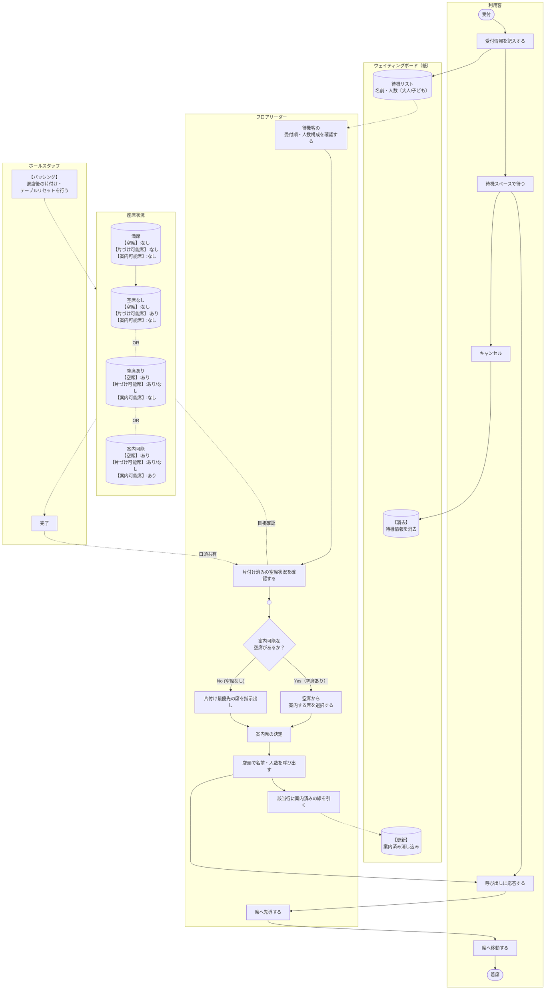

# 飲食店アテンド業務（現状分析／As-Is）

業務分析により作成した業務フロー図を以下に示す。

## 発生条件（トリガー）：

満席後、来店客が店頭のウェイティングボードに記入した時点

## 始点・終点：

• 始点：受付（来店〜ボード記入完了）\
• 終点：着席（最終的な案内先テーブルへの着席完了）

## ウェイティングボードの記入項目：

名前(カナ)、人数、大人/子供の区別、備考

## 例外処理（フロー図無反映）：

1. 先頭人数と席が不一致の場合\
（待機順を前後させて案内可能な組を優先）
2. 呼び出し時に不在の場合\
（ボードに不在印をつけ、次の待機組へ進む）
3. 席へ先導後に別の席を希望された場合\
（空席再確認・テーブルリセットのうえ再誘導）
